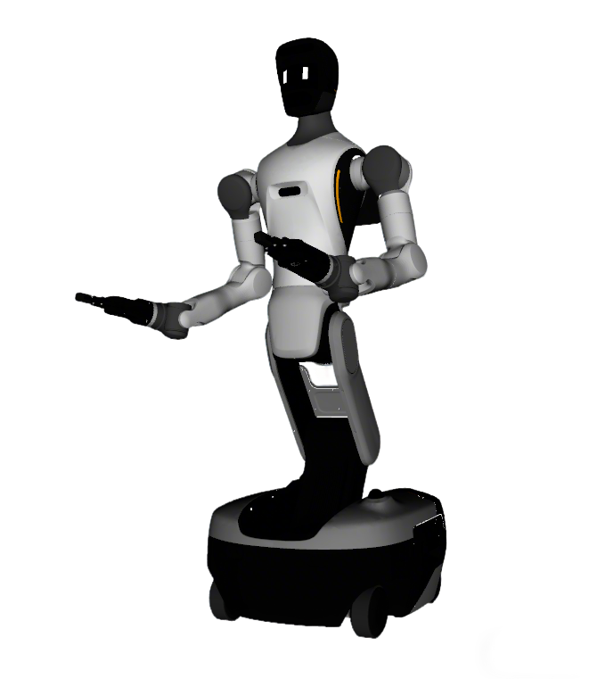

# Agibot G2 Description

This package contains the description files for Agibot Genie G2 humanoid. The origin models could be found at [GenieSim 3.0 Assets](https://modelscope.cn/datasets/agibot_world/GenieSimAssets).

## 1. Build
```bash
cd ~/ros2_ws
colcon build --packages-up-to agibot_g2_description --symlink-install
```

## 2. Visualize the robot
### 2.1 Full Robot
* Empty Hand
  ```bash
  source ~/ros2_ws/install/setup.bash
  ros2 launch robot_common_launch manipulator.launch.py robot:=agibot_g2 collider:=simple
  ```
* With ChangingTek AG2F90
  ```bash
  source ~/ros2_ws/install/setup.bash
  ros2 launch robot_common_launch manipulator.launch.py robot:=agibot_g2 type:=ag2f90
  ```
  
### 2.2 Component
* Base
  ```bash
  source ~/ros2_ws/install/setup.bash
  ros2 launch robot_common_launch component.launch.py robot:=agibot_g2
  ```
* body
  ```bash
  source ~/ros2_ws/install/setup.bash
  ros2 launch robot_common_launch component.launch.py robot:=agibot_g2 type:=body
  ```
* Arms
  ```bash
  source ~/ros2_ws/install/setup.bash
  ros2 launch robot_common_launch component.launch.py robot:=agibot_g2 type:=arms
  ```
  
## 3. OCS2 Demo

### 3.1 Official OCS2 Mobile Manipulator Demo

```bash
source ~/ros2_ws/install/setup.bash
ros2 launch robot_common_launch manipulator_ocs2.launch.py robot_name:=agibot_g2
```


### 3.2 Mock Components

* Full Body Control
  ```bash
  source ~/ros2_ws/install/setup.bash
  ros2 launch ocs2_arm_controller full_body.launch.py robot:=agibot_g2 type:=ag2f90
  ```

### 3.3 Isaac Sim Simulation
* Full Body Control
  ```bash
  source ~/ros2_ws/install/setup.bash
  ros2 launch ocs2_arm_controller full_body.launch.py robot:=agibot_g2 type:=ag2f90 hardware:=isaac
  ```